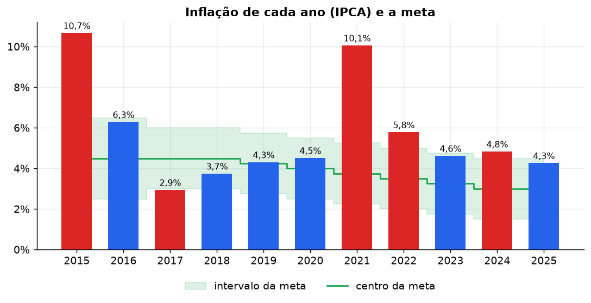
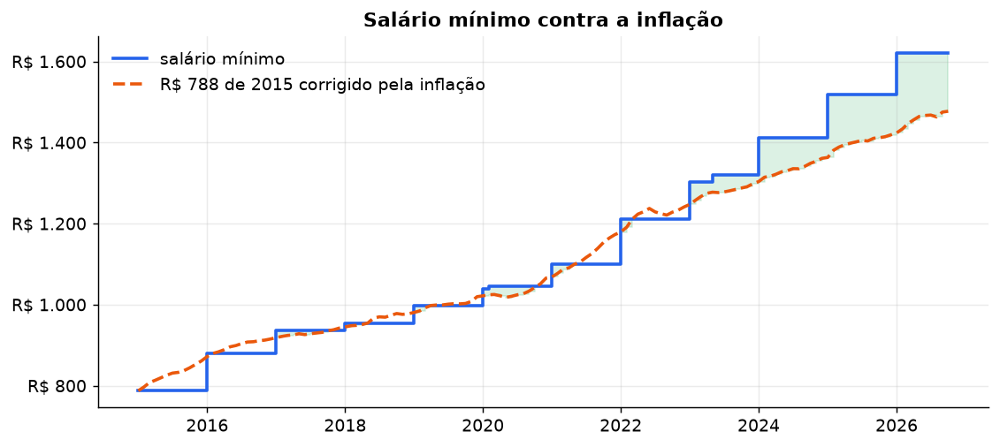
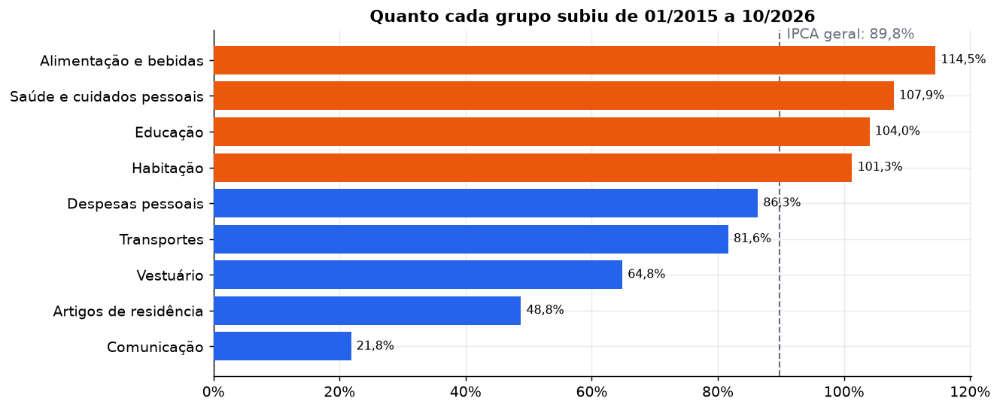
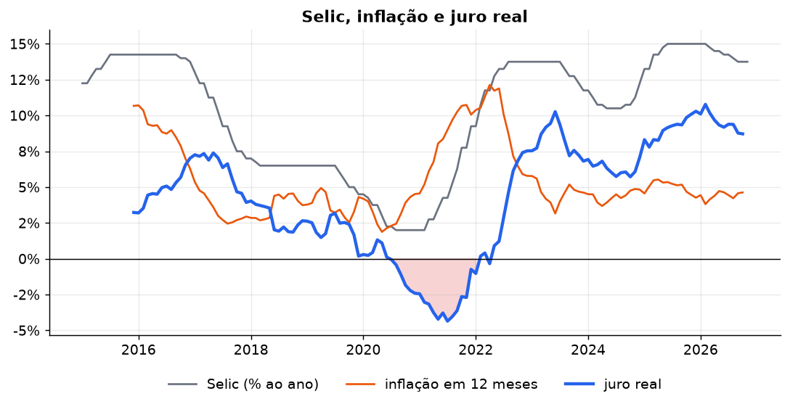

# Inflação, salário mínimo, juros e dólar (2015 a 2026)

Análise em **Python (pandas + matplotlib)** com dados abertos do **Banco Central**, respondendo
perguntas simples sobre o bolso de quem vive no Brasil. A análise completa, com o código e os
gráficos, está no **[notebook](analise.ipynb)** (o GitHub mostra ele já executado).

## O que os dados mostram

**1. Os preços quase dobraram.** O IPCA acumulou **89,8%** de janeiro de 2015 a outubro de 2026:
o que custava R$ 100,00 passou a custar R$ 189,82. A inflação passou do teto da meta em 2015,
2021, 2022 e 2024, e ficou abaixo do piso em 2017.



**2. O salário mínimo dobrou no papel, mas ganhou só uns 10% de poder de compra.** Foi de R$ 788
para R$ 1.621 (+106%), e quase tudo isso só repôs a inflação. Em 2021 e 2022 ele passou boa
parte do ano abaixo da linha da inflação; o ganho real aparece a partir de 2023.



**3. Comida, saúde, educação e moradia subiram mais que a média.** Todos esses grupos passaram
de 100% no período, contra 90% do IPCA geral. Como pesam mais no orçamento de quem ganha menos,
essas famílias sentiram uma inflação maior que a oficial.



**4. O juro real ficou negativo e depois foi a quase 10%.** De meados de 2020 ao começo de
2022, a Selic em 2% ficou abaixo da inflação: dinheiro parado em renda fixa perdia valor. Depois
os juros subiram forte e o juro real chegou perto de 10% ao ano.



**5. O dólar subiu mais que os preços aqui** (+110% contra +90%), com um salto grande em 2020.

## Como os números foram conferidos

- As contas ficam em funções pequenas (`inflacao/calculos.py`) e cada uma tem teste com um
  exemplo feito à mão. Exemplo do motivo: inflação de 1% e depois 2% dá **3,02%**, não 3%,
  porque as variações se multiplicam. Somar meses é o erro mais comum nesse tipo de conta.
- Antes de usar as séries do IPCA por grupo, conferi se os códigos do Banco Central eram mesmo
  os grupos que eu achava. Comparei a inflação de 2022 calculada com a divulgada pelo IBGE, e
  todos os grupos bateram com diferença de até 0,02 ponto (arredondamento dos dados mensais).
  O IPCA de 2015 calculado também bate: 10,67%.

## Limites

- O IPCA mede famílias com renda de 1 a 40 salários mínimos em 16 capitais, não uma família
  ou cidade específica.
- O juro real aqui usa a inflação passada (12 meses). O mercado costuma olhar a inflação esperada.
- Salário mínimo não é renda média.

## Rodando

```bash
python -m venv .venv
.venv/bin/pip install -e ".[dev]"
python -m inflacao.coleta              # baixa as séries (já estão em dados/, só baixa o que faltar)
python -m inflacao.coleta --atualizar  # baixa tudo de novo, com os meses mais recentes
pytest
jupyter notebook analise.ipynb
```

A API do Banco Central é pública e não pede chave: `https://api.bcb.gov.br/dados/serie/bcdata.sgs.{codigo}/dados`.
Séries usadas: IPCA (433), IPCA por grupo (1635 a 1643), salário mínimo (1619), meta Selic (432)
e dólar (1). Séries diárias só vêm em pedaços de até 10 anos, então o download é feito em janelas.

## Estrutura

```
inflacao/
  coleta.py     download das séries do Banco Central, com nova tentativa se a API falhar
  calculos.py   inflação acumulada, em 12 meses, por ano, valor corrigido, ganho e juro real
analise.ipynb   a análise, com texto e gráficos
dados/          as séries baixadas (CSV), pra análise rodar sem internet
docs/           os gráficos usados neste README
tests/          testes das contas
```

## Licença

MIT. Os dados são do Banco Central do Brasil (dados abertos).
